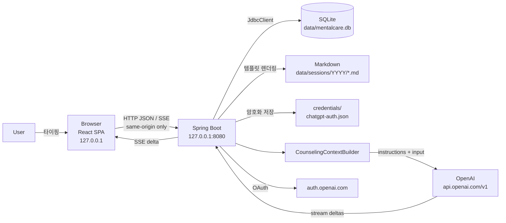

# DATA_FLOW.md — 상담 데이터는 어디로 가는가

이 문서는 mentalcare에서 개인정보(상담 내용)가 이동하는 모든 경로를 단계별로 적습니다.
외부로 나가는 대상은 **OpenAI뿐**이며, 각 요청에 어떤 필드가 들어가는지 명시합니다.

## 전체 흐름

## 단계별 이동 정보

### 1. User → Browser
- 체크인 점수(1~10, 선택), 체크인 메모, 상담 메시지, 기억 수정 내용, 프로필/목표.
- 브라우저는 아무것도 영구 저장하지 않습니다(`localStorage`/`sessionStorage`/cookie 미사용). 페이지 상태는 메모리뿐.

### 2. Browser → Spring Boot (127.0.0.1:8080)
| 요청 | 이동 데이터 |
|---|---|
| `POST /api/sessions` | 체크인 점수·메모 |
| `POST /api/sessions/{id}/messages` | 사용자 메시지 1건 |
| `POST /api/sessions/{id}/opening` | 없음 |
| `POST /api/sessions/{id}/complete` | 없음 (서버가 DB에서 대화를 읽음) |
| `POST /api/sessions/{id}/retry` | 없음 (서버가 저장된 마지막 사용자 메시지를 재사용) |
| `POST /api/sessions/{id}/draft` | 작성 중 텍스트(초안) 1건; 탭 종료 시 `keepalive`로 전송 |
| `GET /api/sessions?q=&from=&to=&tag=` | 검색어·기간·태그 (서버 내부 SQLite LIKE 검색, 외부 전송 없음) |
| `GET /api/sessions/{id}/context` | 없음 — 응답으로 기억·요약 목록·메시지 포함/생략 수를 받음(프롬프트 원문은 없음) |
| `GET /api/backup?credentials=` | 없음 — 응답으로 zip(DB 스냅샷·Markdown·선택 시 암호화된 자격증명)을 내려받음 |
| `POST /api/backup/inspect`, `POST /api/backup/restore` | 백업 zip 업로드(+`confirmation=RESTORE`, `credentials=`) |
| `GET /api/system/status`, `POST /api/system/shutdown` | 없음 / `{"ifIdle":true}` |
| `PATCH /api/memories/{id}` | 기억 내용/상태 |
| `PATCH /api/settings` | 프로필, 목표, 모델 선택, reasoning |
| `POST /api/auth/chatgpt/start` | 돌아올 loopback URL |
| `GET /api/auth/chatgpt/callback` | OpenAI가 붙인 `code`, `state`, `client_id`, `scope` (브라우저는 보기만 함) |

응답으로 브라우저가 받는 것: 세션/메시지/요약/기억 JSON, 인증 **상태**(이메일, scope 목록, 만료 시각). **토큰은 절대 포함되지 않습니다.**

### 3. Spring Boot → SQLite (`data/mentalcare.db`)
- `sessions`, `messages`(원문), `weekly_checkins`, `session_summaries`(요약 JSON), `memories`, `memory_observations`, `tags`, `safety_events`(점수·판정만), `api_usage`(토큰 수만), `app_settings`(프로필/목표/모델 선택/welcome 플래그/마지막 백업 시각), `prompt_versions`, `drafts`(세션당 작성 중 텍스트 1건, 전송·종료·삭제 시 제거).
- 저장되지 않는 것: OAuth 토큰, API 키, 요청/응답 raw JSON.

### 4. Spring Boot → Markdown (`data/sessions/YYYY/YYYY-MM-DD[-id].md`)
- 상담 종료 시 요약 JSON을 Java 템플릿으로 렌더링: 날짜, 체크인, 주제, 사용자가 말한 사건/감정/생각, AI 관찰 패턴(해석 표시), 행동 항목, 다음 상담 항목, 태그.
- 원본 대화 전문은 Markdown에 **쓰지 않습니다**(요약만). 토큰/경로/설정은 포함되지 않음.

### 5. Spring Boot → credentials (`data/credentials/`)
- `chatgpt-host.json`: `ext_agent_host_id` (urn:uuid, 비밀 아님).
- `chatgpt-auth.json`: `{version, provider, ciphertext}` — 복호화하면 issued client_id, subject, email, name, scopes, access/refresh/ID token, 만료 시각. Windows는 DPAPI, 그 외는 AES-256-GCM(`.master.key`).

### 6. ContextBuilder → OpenAI (`POST /v1/responses`, 상담 응답)

요청 본문(항상 `store:false`, `stream:true`):

| 필드 | 내용 | 출처 |
|---|---|---|
| `model` | 선택된 상담 모델 slug | 설정/카탈로그 |
| `instructions` | 시스템 프롬프트(`counselor-system-v2`) + (안전 모드 지시) + `<<<DATA 프로필>>>` + `<<<DATA 장기 기억>>>`(ACTIVE만, 최대 30) + `<<<DATA 최근 상담 요약>>>`(최근 N회, 기본 3; 요약 필드당 최대 5항목) + `<<<DATA 이번 상담>>>`(날짜, 체크인, 메모) | DB |
| `input[]` | 현재 세션의 모든 메시지 (`user`/`assistant`), 첫 턴에는 `developer` cue 1개 | DB |
| `reasoning.effort` | low/medium/high | 설정 |
| `max_output_tokens` | **API 키 모드에서만** | 설정 |

보내지 **않는** 것: 과거 세션 원문, 전체 DB, Markdown 파일, 파일 경로, application.yml 값, OAuth 자격증명, 환경변수, CANDIDATE/ARCHIVED 기억, 사용자 식별자(이메일 등).

### 7. Spring Boot → OpenAI (`POST /v1/responses`, 상담 요약 / Structured Output)
- `instructions`: `session-summary-v1` 프롬프트.
- `input[0]` (user): 상담 날짜, 체크인, **기존 기억 목록(id + 내용, CANDIDATE/ACTIVE)**, **현재 세션 대화 전체**.
- `text.format`: strict JSON schema(`session-summary.schema.json`).

### 8. Spring Boot → OpenAI (`POST /v1/responses`, 위기 평가)
- 신호(Moderation 또는 키워드)가 있을 때만. `input`: 최근 메시지 최대 6개. strict JSON schema.

### 9. Spring Boot → OpenAI (`POST /v1/moderations`)
- 사용자 메시지 1건의 본문. ChatGPT 플랜 모드에서 라우트가 허용되지 않으면 30분간 건너뜀.

### 10. Spring Boot → OpenAI (`GET /v1/models`)
- 본문 없음. 응답의 `models[].slug/display_name/visibility`만 사용.

### 11. Spring Boot ↔ auth.openai.com
| 단계 | 전송 |
|---|---|
| discovery | `GET /.well-known/openid-configuration` (본문 없음) |
| authorize (브라우저 이동) | `client_id`, `redirect_uri`(127.0.0.1), `scope`, `resource`, `state`, `nonce`, `code_challenge`, `ext_agent_host_id`, `agent_name_hint`(최초), `login_hint`/`id_token_hint`(재로그인), `prompt=consent`(재승인) |
| token | `grant_type`, `client_id`, `code`+`code_verifier` 또는 `refresh_token`, `redirect_uri`, `resource` |
| revoke | `token`(refresh), `token_type_hint`, `client_id` |
| jwks | `GET` (본문 없음) |

### 11-1. 이관 기록 가져오기 (Browser → Spring Boot → SQLite)
- 사용자가 설정 화면에서 고른 Markdown 파일이 multipart 업로드로 백엔드에 전달됩니다(같은 PC, 2MB 제한). 서버는 임의 경로를 읽지 않습니다.
- 저장: `sessions`(kind=IMPORTED), `session_summaries`(섹션별 요약 + `importedContext`), `imported_archives`(원문 Markdown), `memories`/`memory_observations`(후보, CANDIDATE), `tags`(imported).
- **OpenAI로 가는 것**: 이후 상담 요청의 `instructions` 안 `<<<DATA 이관된 과거 기록>>>` 블록에 각 이관 기록의 "핵심 맥락" 텍스트(총 6,000자 상한)가 들어갑니다. 원문 Markdown 전체나 섹션 전체는 보내지 않습니다. 이관 후보가 ACTIVE로 확정되면 장기 기억 블록으로도 전달됩니다.

### 11-2. 백업과 복원 (Spring Boot ↔ 파일 시스템)
- 백업: `VACUUM INTO`로 `data/backups/.snapshot-*.db`를 만들어 zip에 넣고 즉시 삭제. Markdown은 `markdownDir` 기준 상대 경로로 수록. 자격증명은 사용자가 체크한 경우에만 암호화 파일 그대로. 완성된 zip은 브라우저로 스트리밍 후 삭제되며 서버에는 남지 않음.
- 복원: 업로드된 zip을 `data/backups/.work-*`에 안전하게 풀고(allow-list 경로만), DB 검증 후 **복원 전 스냅샷** `before-restore-*.zip`을 먼저 기록 → 새 Markdown 폴더를 옆에 준비 → 한 트랜잭션에서 모든 테이블의 행 교체와 폴더 swap(실패 시 둘 다 되돌림) → 작업 폴더 삭제. 전체 삭제 시 `before-restore-*.zip`도 기본으로 함께 삭제. OpenAI 등 외부로 나가는 데이터는 없음.
- 로그에는 건수·바이트 수·파일 수만 기록.

## 12. OpenAI → Spring Boot → Browser
- SSE `response.output_text.delta` → 백엔드가 DB에 누적 저장 → 브라우저에 `delta` 이벤트 전달.
- `response.completed`의 `usage`만 `api_usage`에 기록.

## 로그에 남는 것

세션 id, 메시지 id, 모델명, 토큰 수, 오류 종류(kind)·provider code, 안전 판정(risk level, 신호 여부). **본문·토큰·URL·요청 JSON은 기록되지 않습니다.** 테스트(`counselingTextNeverReachesApplicationLogs`)가 이를 검증합니다.

## OpenAI 이외의 outbound 연결

없음. 프론트엔드 번들은 백엔드가 자체 호스팅하며 외부 폰트/스크립트/분석 도구를 로드하지 않습니다(CSP `default-src 'self'`). Docker 빌드 시 npm/Maven 레지스트리 접근은 빌드 단계에만 발생하고 상담 데이터는 관여하지 않습니다.
